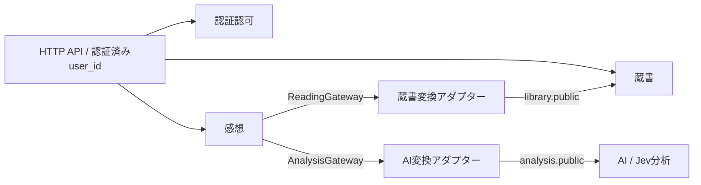

# DDDコンテキストと依存関係

## 所有する責務

| コンテキスト | パッケージ | 業務・データの所有 |
| --- | --- | --- |
| 認証認可 | `backend.identity` | ユーザープロフィール、認証情報、メール確認、パスワード再設定、セッション、本人操作の認可 |
| 蔵書 | `backend.library` | 書誌、Google Books・Redisキャッシュ、本棚、読書回、読了、読書進捗 |
| 感想 | `backend.reviews` | ページ別本文、改訂番号、解析状態、感想一覧、ページ別集計 |
| AI（Jev）分析 | `backend.analysis` | Jev・モック分析、8感情モデル、色変換、分析履歴、実AI結果の集約 |

各コンテキストは `domain / application / infrastructure / presentation` を持ちます。
AI分析は現在、感想側のポートから利用する内部アプリケーションAPIであり、独立した公開RESTエンドポイントは追加していません。

- domain: 標準ライブラリのみ。エンティティ・値オブジェクト・業務ルール・業務例外を置きます。
- application: 自身のdomainと同層のみに依存し、ユースケース・結果DTO・外部依存のProtocol・Unit of Workのポートを置きます。
- infrastructure: 自身のdomain/applicationのポートを実装し、自身のORMと外部I/Oを扱います。リポジトリはcommitしません。
- presentation: 自身のユースケースと、共通のHTTP認証境界を使います。HTTPステータス、Cookie、入力・出力スキーマを扱い、具体的なインフラを組み立てません。
- public.py: 境界で公開するProtocol・DTO・失敗の型です。他コンテキストのエンティティやORMは公開しません。

## 必要な連携



図の矢印は実行時の連携です。感想のコードが蔵書やAIの実装をimportする依存ではありません。
感想は自身で定義した `ReadingGateway` / `AnalysisGateway` に依存し、`integration/` のアダプターが
公開契約を通じて変換します。蔵書・AI側は感想コンテキストを参照しません。

- `integration/reviews_library.py`: 読書回・所有確認・総ページ数・進捗を、感想側の `ReadingScope` に変換します。蔵書側の例外も感想側の型へ変換します。
- `integration/reviews_analysis.py`: 分析要求と、色・source・集約結果を感想側のDTOへ変換します。分析の失敗を、本文保存済みのユースケースが扱える型へ変換します。
- `integration/reviews_identity.py`: 登録名やメールを含まない公開用表示名の集合を、感想側の公開投稿者ポートへ変換します。
- `integration/identity.py`: 公開された認証結果を共通HTTP認証ポートへ変換します。
- `composition/identity.py` / `composition/reading.py`: 環境設定、具象アダプター、Unit of Work、FastAPIの依存注入を組み立てます。
- `composition/schema.py`: 全ORMモデルを登録します。コンテキスト自身に他のモデルをimportさせません。
- `shared/`: DB接続・メタデータ、SQLトランザクションの技術的な管理、UTC時計、HTTPの認証境界・例外変換のみです。業務モデルと他コンテキストへの依存を持ちません。

各コンテキスト内から兄弟コンテキストへのimportは禁止です。アダプターからも兄弟の内部モジュールはimportせず、`public.py` のみを使用します。
具象クラスを横断して知るのはcomposition rootです。共通の巨大Repositoryや横断ORM JOINは置きません。
旧 `backend/domain` / `application` / `presentation` と混在Repositoryは廃止しました。
既存Alembic履歴の配置は `backend/infrastructure/migrations/` のままです。

## 感想保存と整合性

1. 蔵書の公開契約で、本人の読書回・本の総ページ数を解決します。
2. 感想のUnit of Workを開きます。composition rootが、このSQLセッションに参加する蔵書アダプターを渡します。
3. 蔵書ユースケースが対象の読書回をロックし、読了済みでないこととページ範囲を確認して進捗を更新します。
4. 感想ドメインが本文を正規化し、新規作成または改訂番号を増やしてpendingにします。本文と進捗を同時にcommitします。
5. トランザクションを閉じてからAI分析を依頼します。Jev呼び出し中にDBロックを保持しません。
6. AI分析コンテキストが `review_id + revision` をキーに、自身の履歴を保存します。
7. 感想を再取得・ロックし、現在の改訂番号が一致する場合だけ解析状態をcompleted/failedにします。

借用した蔵書Unit of Workは独立したcommit/rollback/closeを行わず、感想の外側トランザクションが確定します。
これは同一PostgreSQL上のモジュラーモノリスとしての技術的な協調です。感想やアダプターが蔵書ORMへ直接アクセスすることはありません。

解析失敗時も本文・進捗は保持します。古い改訂の分析履歴が残っても、現在の改訂と一致した結果だけを表示します。
解析状態とAI結果はコンテキストをまたぐため、本文のcommitと分析完了の間にはpendingの期間があります。
分析結果保存後、感想の解析状態更新前にプロセスが停止した場合の再配送・自動再解析は、今回追加していません。

集計も横断JOINを使いません。蔵書が対象読書回IDを提供し、感想が対象の現在改訂IDを選び、AIがその集合の実Jev結果を集約します。
ページ別集計は各ユーザーの最新読書回、感情平均は既存仕様どおり全読書回の現在の感想改訂が対象です。
多数の参照IDは1,000件ずつSQLへ渡し、パラメーター数上限を避けます。
集計は複数の公開APIを順に読むため、同時更新中にはコンテキスト間で結果が一時的にずれる可能性があります。

公開感想一覧も横断JOINを使いません。蔵書がGoogle Books IDに対応する全読書回のキーを提供し、
認証認可が対象投稿者の設定済み公開用表示名を提供します。感想は対象読書回の `public` 本文だけを、
ページ条件・更新日時順・ページングで返します。詳細は [公開感想一覧API](public-reviews.md) を参照してください。

## DBとAPIの互換性

| テーブル | 所有コンテキスト |
| --- | --- |
| users / auth_credentials / auth_sessions / auth_challenges / auth_rate_limits | 認証認可 |
| books / user_books | 蔵書 |
| page_reviews | 感想 |
| emotion_analyses | AI分析 |

既存テーブル名・カラム・制約・インデックス・FKは維持しています。この分離に伴う追加マイグレーションは不要です。
まだ0009を適用していない環境は、認証用の既存マイグレーションを適用してください。

DB上の次の依存は意図的に残します。

- `user_books.user_id → users.id`
- `page_reviews.user_book_id → user_books.id`
- `emotion_analyses.review_id → page_reviews.id`

これはスキーマ互換性と削除時CASCADEのための物理依存です。独立したDBへ分割できる構成になった、という意味ではありません。
将来DBも分離する場合は、外部キーとCASCADEをイベント・削除伝播に置き換える設計が別途必要です。

既存21パスのAPIは維持しています。`/books`・`/fetch` は蔵書、感想・ページ別集計・感情集約は感想、`/users` は認証認可がHTTPを所有します。
フロントエンドのAPI URLやレスポンス形式の変更は不要です。

## コードと依存関係の確認

```bash
# fastapi/ で実行。動作テストは行いません。
python3 scripts/check_context_dependencies.py
uv run ruff check src/backend scripts
```

依存チェッカーはソースをAST解析し、以下を確認します。

- domain/applicationの依存先。
- コンテキストから他コンテキストへの直接import。
- 層の逆向き依存、sharedからコンテキストへの依存。
- integrationによる公開契約の迂回。
- 存在しない内部モジュールへのimportと循環参照。

今回、118モジュールの静的依存確認、実行専用のAlembic env.pyを除く90モジュールのimport、
OpenAPI生成と旧17操作のパス・メソッド照合、全9テーブルのFK解決、既存5業務テーブルのスキーマ比較を行いました。
Pythonのlint・format、フロントエンドの型、lockファイルと導入パッケージの整合性も確認しています。

DB・SMTP・Jevへの接続、マイグレーション適用、テスト・commitは行っていません。
既存テストは旧パッケージ・旧サービス構成向けのままで、今回実行・書き換えをしていません。
今後実行する場合は新しいコンテキストとポートを使う構成へ追従する必要があります。
